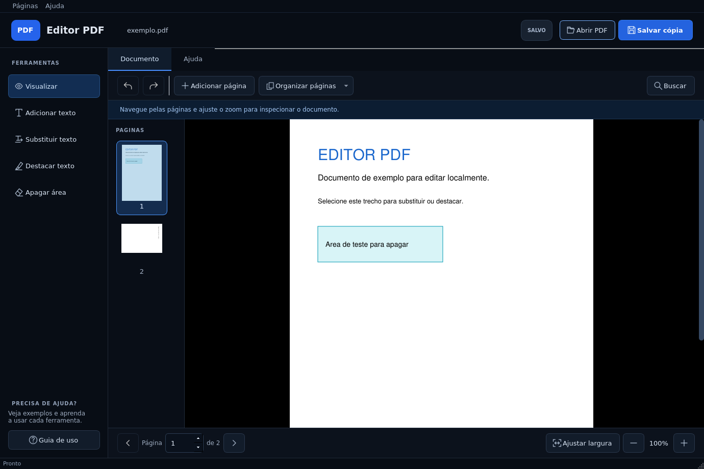

# Editor de PDF

Editor desktop em português para abrir, editar e organizar PDFs. Feito em **Python, PySide6 e PyMuPDF**, com interface escura e destaques em azul. Funciona localmente e sem internet depois da instalação.

> **Este projeto foi vibe codado:** foi desenvolvido de forma iterativa com assistência de IA (Codex), a partir de instruções, testes e ajustes solicitados pelo autor. A participação da IA não significa que o programa esteja livre de erros. As verificações realizadas e os pontos ainda não validados estão no [relatório de validação](VALIDACAO.md).



## Windows: baixar e abrir

**[⬇ Baixar o Editor para Windows x64](https://github.com/Muzi3060/EditorDePdf/releases/latest/download/EditorPDF-Windows-x64.zip)**

1. Baixe o ZIP pelo botão acima ou pela seção **[Releases](https://github.com/Muzi3060/EditorDePdf/releases)** à direita do repositório.
2. Clique com o botão direito no ZIP e escolha **Extrair Tudo**.
3. Abra a pasta extraída e dê dois cliques em **EditorPDF.exe**.
4. Para encontrá-lo facilmente depois, crie um atalho de `EditorPDF.exe` na Área de Trabalho. No Windows 11, a opção pode ficar em **Mostrar mais opções → Enviar para → Área de Trabalho (criar atalho)**.

**Não precisa instalar Python, criar conta ou usar internet para executar o pacote pronto.** Mantenha a pasta `_internal` junto do executável. O aplicativo é portátil: não é um instalador e não cria atalhos automaticamente.

Alvo inicial: **Windows 10/11 de 64 bits (x64)**. O pacote e as bibliotecas Windows foram testados via Wine no Linux; **o uso em Windows nativo ainda precisa ser validado**. Consulte [WINDOWS.md](WINDOWS.md) se precisar de ajuda ou quiser gerar o executável por conta própria.

## O que ele faz

- Abre PDFs, navega por miniaturas e ajusta o zoom.
- Adiciona texto com tamanho e cor, substitui trechos e destaca palavras.
- Remove efetivamente conteúdo de uma área selecionada.
- Insere páginas em branco e importa páginas de outro PDF.
- Duplica, move, gira, exclui e extrai páginas.
- Busca texto, desfaz/refaz alterações e salva uma cópia sem sobrescrever o original.
- Inclui ajuda detalhada dentro do aplicativo, pela aba **Ajuda** ou tecla **F1**.

## Executar pelo código-fonte

Requer **Python 3.10 a 3.14**. No Windows, recomenda-se Python 3.12 ou 3.13 de 64 bits.

```bash
git clone https://github.com/Muzi3060/EditorDePdf.git
cd EditorDePdf
```

### Windows

Instale o [Python x64](https://www.python.org/downloads/windows/) e dê dois cliques em **iniciar_windows.bat**. Na primeira vez, o script cria um ambiente virtual e instala as dependências; essa etapa requer internet. Nas próximas execuções o uso é offline.

### Linux

```bash
python3 -m venv .venv
source .venv/bin/activate
python -m pip install -r requirements.txt
python main.py
```

Para abrir diretamente um documento: `python main.py exemplo.pdf`.

Para executar os testes:

```bash
QT_QPA_PLATFORM=offscreen python -m unittest -v test_editor.py
```

O comando acima usa a sintaxe de shell Linux. No Windows, os testes podem ser executados com `python -m unittest -v test_editor.py`; o próprio teste configura o modo offscreen.

## Limitações importantes

A substituição de texto é feita em trechos de uma linha, sem reorganizar os parágrafos seguintes. A fonte pode ser aproximada e o texto novo precisa caber no espaço disponível. PDFs escaneados podem receber texto e apagamentos, mas **não há OCR** para reconhecer palavras em imagens.

O histórico fica na memória durante a sessão. PDFs grandes ou complexos podem exigir mais memória e tempo. A remoção de áreas não limpa automaticamente metadados, anexos ou anotações preexistentes. Confira a cópia salva antes de usá-la como versão final.

## Documentação

- [Instruções completas e licenças das dependências](DOCUMENTACAO.md)
- [Windows: instalação, solução de problemas e geração do executável](WINDOWS.md)
- [O que foi testado e o que falta validar](VALIDACAO.md)
- [Pesquisa e decisões de interface](DESIGN.md)
- [Pesquisa de funções e possíveis melhorias](PESQUISA.md)

Encontrou um problema? [Abra uma issue](https://github.com/Muzi3060/EditorDePdf/issues) com a versão do sistema, os passos para reproduzir e a mensagem de erro. Evite anexar PDFs com informações pessoais.

## Licença

Código do projeto sob **AGPL-3.0-or-later**. Veja [LICENSE.txt](LICENSE.txt). PyMuPDF/MuPDF usa a edição aberta AGPL; PySide6/Qt usa as licenças comunitárias aplicáveis. Avisos e textos adicionais estão em [third_party_licenses](third_party_licenses) e na [documentação](DOCUMENTACAO.md).

Não há login, nuvem, servidor, colaboração, assinatura digital ou recursos pagos.
